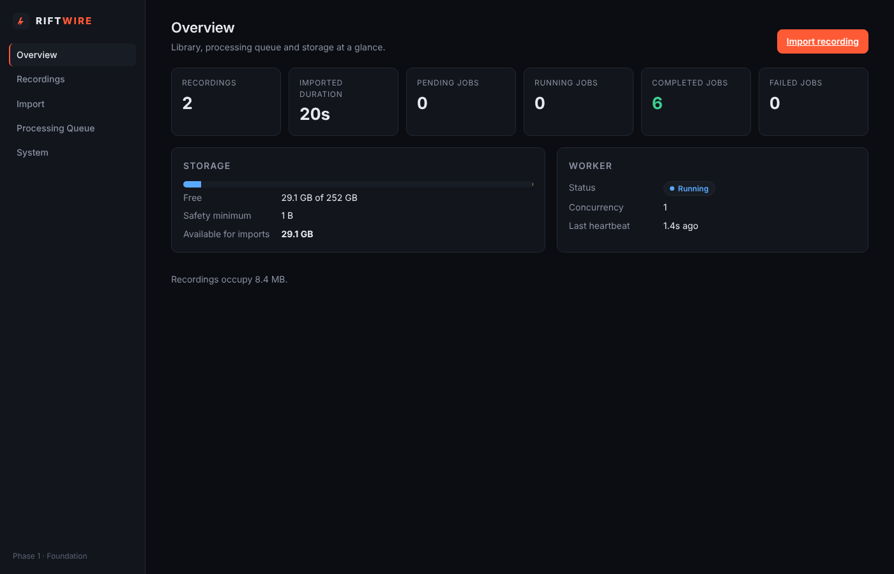

# RIFTWIRE

Local-first, AI-powered gaming media automation platform. RIFTWIRE will turn authorized
long-form gameplay recordings (initially GTA VI) into short-form 9:16 videos.

**Current state: Phase 1 — Foundation (v0.1.0).** Reliable local ingestion of recordings,
technical metadata, thumbnails, a crash-safe persistent job queue, and a local dashboard.
No AI clipping, editing or publishing yet. See [`docs/PHASE1_REPORT.md`](docs/PHASE1_REPORT.md)
for exactly what has been verified.



## Quick start (macOS, Apple Silicon)

Prerequisites (see [`docs/INSTALLATION.md`](docs/INSTALLATION.md)): Python 3.13, Node.js ≥ 20,
FFmpeg (`brew install ffmpeg`).

```bash
git clone https://github.com/Stork1212/riftwire.git ~/Claude/riftwire
cd ~/Claude/riftwire
scripts/bootstrap.sh      # project-local venv + node_modules + .env (no system installs)
scripts/start.sh          # migrations, API + worker, dashboard at http://127.0.0.1:8000
scripts/stop.sh           # graceful shutdown
```

## What it does (Phase 1)

| | |
|---|---|
| Import | MP4 / MOV / MKV / WEBM, streamed to disk (never into memory), validated by content (ffprobe + decode at start *and* end), SHA-256 fingerprint, duplicate detection |
| Crash safety | DB intent row → idempotent link/fsync/unlink finalize; startup reconciler; nothing in `recordings/` is ever deleted or overwritten |
| Queue | SQLite-backed, survives restarts; atomic claiming, per-attempt fencing tokens, leases + heartbeats, exponential backoff, orphaned-FFmpeg cleanup, single-worker OS lock |
| Metadata | duration, display resolution (rotation/SAR aware), exact rational frame rate + VFR flag, codecs, audio presence, container |
| Thumbnails | aspect-preserving, deterministic, never regenerated when valid, fallback frame + placeholder |
| Dashboard | Overview, Recordings (+ detail), Import (upload vs. processing progress), Processing Queue (retry), System |
| Safety | API bound to 127.0.0.1, restricted CORS, 60 GiB free-space floor, no server paths in API errors |

## Layout

```
backend/    FastAPI app, worker, SQLAlchemy models, Alembic migrations, pytest suite
frontend/   React + TypeScript + Vite dashboard, Vitest suite
scripts/    bootstrap, migrate, start, stop, status, test, acceptance.py, discover_env.sh
docs/       ARCHITECTURE, INSTALLATION, TESTING, TROUBLESHOOTING, PHASE1_REPORT, PROJECT_STATUS
data/       runtime data (git-ignored; relocate with RIFTWIRE_DATA_DIR)
```

## Commands

| Task | Command |
|---|---|
| Set up | `scripts/bootstrap.sh` |
| Migrate DB | `scripts/migrate.sh` (`scripts/migrate.sh current` to inspect) |
| Start / stop / status | `scripts/start.sh [--dev]` · `scripts/stop.sh` · `scripts/status.sh` |
| All tests + build | `scripts/test.sh` |
| End-to-end acceptance | `backend/.venv/bin/python scripts/acceptance.py` |
| Environment report | `bash scripts/discover_env.sh` |

## Documentation

- [Architecture](docs/ARCHITECTURE.md) · [Installation](docs/INSTALLATION.md) ·
  [Testing](docs/TESTING.md) · [Troubleshooting](docs/TROUBLESHOOTING.md)
- [Phase 1 report](docs/PHASE1_REPORT.md) · [Project status](docs/PROJECT_STATUS.md)
- Engineering rules for humans and AI agents: [`CLAUDE.md`](CLAUDE.md)
